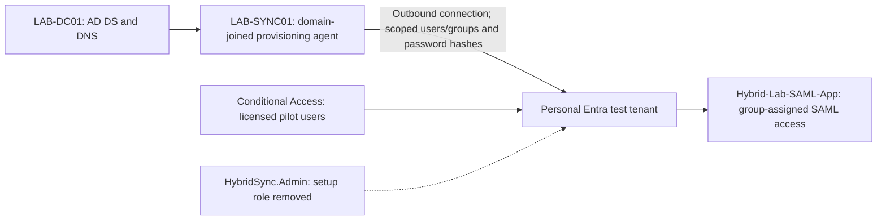

# Hybrid Identity Security Lab

An isolated portfolio lab demonstrating Active Directory as the workforce identity source, Microsoft Entra Cloud Sync, and identity security controls across both directories.

**Status:** Hands-on validation completed October 13–20, 2026. AD-to-Entra provisioning, password hash authentication, MFA policy evaluation, lifecycle changes, delegated password resets, SAML assignment removal, and agent recovery were demonstrated. See [results and limitations](docs/validated-results.md) and the [evidence index](evidence/README.md). This is a personal lab, not a production deployment.

## Architecture

AD forest: `identitylab.local`; NetBIOS: `IDENTITYLAB`. Workforce UPNs use the tenant's actual verified domain, including its initial `onmicrosoft.com` domain when appropriate. The AD DNS name is not a publicly verified sign-in domain.

## Design decisions

- Use two isolated Windows Server 2022 VMs: LAB-DC01 and LAB-SYNC01. A practical starting allocation is 2 vCPU and 4 GB RAM each; this is a lab sizing suggestion, not a vendor minimum. Use a private/NAT lab network with outbound internet for the agent; never expose AD ports to the internet.
- Prefer Cloud Sync with password hash synchronization for this workforce lab. Evaluate Connect Sync instead if hybrid device join is required; this project does not claim to demonstrate device hybrid join.
- Sync only dedicated workforce OUs and selected groups. Keep AD administrators and service accounts outside scope. AD source-of-authority changes are made in AD.
- Separate daily-use identities, AD administrative identities, and cloud-only Entra administrative identities. An AD group with “Privileged” in its name grants no administrative permission by itself.
- Conditional Access requires the appropriate Entra licensing (typically P1); risk-based controls and PIM require additional licensing. Record unavailable controls as design-only, never as implemented.

## Build sequence

1. [Build AD](docs/01-active-directory.md).
2. [Configure synchronization](docs/02-cloud-sync.md).
3. [Exercise security and lifecycle controls](docs/03-security-and-lifecycle.md).
4. [Collect evidence and publish](docs/04-evidence-and-portfolio.md).

Use synthetic identities and a personal tenant only. Scripts have not been executed against AD or Entra in this workspace. Review them before running on the lab server.

## Demonstrated outcomes

| Scenario | Verified outcome |
|---|---|
| Joiner | Casey provisioned through scheduled sync and signed in with the AD password |
| Mover | Taylor changed department and groups without recreating the cloud user |
| Leaver | Alex retained as disabled; fresh sign-in denied with error 50057 |
| Access removal | Enabled Casey lost fresh SAML access after AD group removal; error 50105 |
| Least privilege | Jamie reset a password within Employees and was denied outside it |
| Scope removal | Disposable disabled user soft-deleted after moving outside sync scope |
| Recovery | Pending attribute synchronized after agent restart; later quarantine recovered after provisioning restart |
| Setup cleanup | Setup role removed; successful provisioning cycle observed afterward |

Emergency passkey registration is evidenced for two cloud-only accounts. The supplied portal sign-ins reused claims, so the exact key authentication step is user-reported. Existing app-session termination, Toolkit-local login removal, alert delivery, high availability and bulk-delete protection were not demonstrated.

## Portfolio resources

- [Security review and decisions](docs/security-review.md)
- [Operations and troubleshooting](docs/operations.md)
- [Interview and resume wording](PORTFOLIO.md)
- [Reproduction scripts](scripts/README.md)

Screenshots are selected supplied evidence, not generated examples. No secrets, employer exports or live tenant configuration dumps are included. Repository: [hybrid-identity-security-lab](https://github.com/dccjr17-sudo/hybrid-identity-security-lab).

## Current vendor references

Documentation checked October 13, 2026. Recheck before installing an agent or selecting licenses.

- [Cloud Sync prerequisites](https://learn.microsoft.com/en-us/entra/identity/hybrid/cloud-sync/how-to-prerequisites)
- [Cloud Sync configuration](https://learn.microsoft.com/en-us/entra/identity/hybrid/cloud-sync/how-to-configure)
- [Cloud Sync FAQ](https://learn.microsoft.com/en-us/entra/identity/hybrid/cloud-sync/reference-cloud-sync-faq)
- [Sync tool comparison](https://learn.microsoft.com/en-us/entra/identity/hybrid/sync-tools)
- [Emergency access accounts](https://learn.microsoft.com/en-us/entra/identity/role-based-access-control/security-emergency-access)
- [Entra licensing](https://learn.microsoft.com/en-us/entra/fundamentals/licensing)
